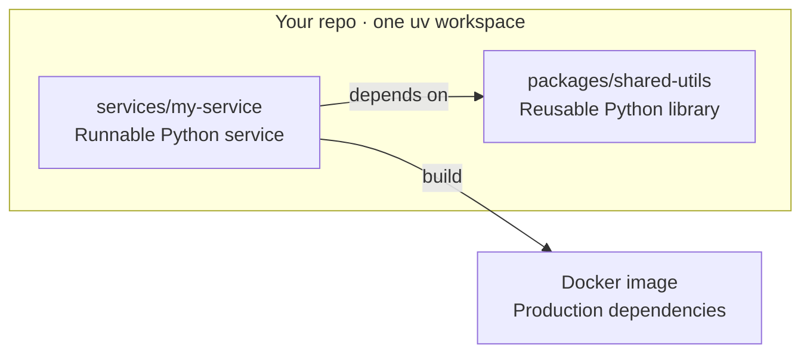

<div align="center">

# 🐍 Python Monorepo Template

**A home for your Python services and the code they share.**

Start with a service, add a shared library, and keep them together in one repo.<br>
Dependency management, tests, formatting, and Docker builds are ready to go.

[](https://www.python.org/)
[](https://docs.astral.sh/uv/)
[](#everyday-workflow)
[](LICENSE)

[**Use this template →**](https://github.com/matanby/python-monorepo-template/generate)

[Quick start](#quick-start) · [Everyday workflow](#everyday-workflow) · [Project map](#project-map) · [Docker](#docker) · [Migration](#migration)

</div>

---

## What you get

- 🐍 **Modern Python.** Python 3.14 by default, with CI checks for 3.12–3.15.
- 🗂️ **One repo, many projects.** Keep your services and shared libraries together.
- ⚡ **Fast setup with uv.** Manage dependencies and virtual environments in one place.
- 🔒 **One shared lockfile.** Give everyone the same dependency versions.
- 🚀 **One-command scaffolding.** Create a service or library with source, tests, and docs.
- 🧩 **Easy code sharing.** Use local libraries without rebuilding them after every edit.
- ✨ **Clean code with Ruff.** Format your Python and catch lint errors.
- 🔎 **Type checks with ty.** Find type errors while you work.
- 🧪 **Tests with pytest.** Run each project's tests independently.
- 🪝 **Optional commit hooks.** Run checks before your changes leave your laptop.
- 🐳 **Docker included.** Build service images with a non-root production runtime.
- 📦 **Ready to package.** Build wheels with type markers and license metadata.
- 🌍 **Cross-platform smoke tests.** Check generated projects on Linux, macOS, and Windows.
- 🤖 **Dependency updates.** Get weekly Dependabot PRs for Python, Actions, and Docker.
- 🛠️ **Commands you'll remember.** Use Make shortcuts or run uv directly.

## Quick start

Let's get your first service running. 🚀

[Create a repo from this template](https://github.com/matanby/python-monorepo-template/generate),
clone it, and open a terminal at its root. You'll need
[uv](https://docs.astral.sh/uv/getting-started/installation/) 0.11+, GNU Make, and
Python 3.12+ available as `python3`. See [Working without Make](#working-without-make)
for direct commands, including on Windows.

```sh
# Set up the workspace (uv downloads Python 3.14 if needed)
uv sync --all-packages --locked

# Create a library and a service that can use it
make new-package name=shared-utils
make new-service name=my-service
uv add --package my-service --workspace shared-utils
uv sync --all-packages --locked

# Say hello
make -C services/my-service run
```

```text
Hello from my-service!
```

Your library imports as `shared_utils`. Start adding code, then run `make check`
to check lint, types, tests, and formatting. Commit your new projects along with
`uv.lock` so everyone gets the same dependencies.

<details>
<summary><strong>A few things to know about new projects</strong></summary>

Names start with a lowercase letter and may contain lowercase letters, digits,
hyphens, or underscores. `shared-utils` becomes `packages/shared-utils` with an
import name of `shared_utils`. Names must be unique across services and libraries;
Python keywords and standard-library module names are rejected.

The generator works offline. After creating a project, run `uv lock` and
`uv sync --all-packages --locked` (adding a dependency with `uv add` also updates
the lockfile). Each project uses a `src/` layout and includes license metadata
and a `py.typed` marker for tools that use its type annotations.

</details>

## Everyday workflow

Run these at the repo root, or use `make -C <project>` for a single project.

| Command | What it does |
| --- | --- |
| `make install` | Install all projects and the locked development tools |
| `make format` | Format your Python code |
| `make check` | Run lint, types, tests, and a formatting check |
| `make lint` / `make typecheck` / `make test` | Run just one kind of check |
| `make -C packages/shared-utils test` | Test a single project |
| `make smoke` | Generate sample projects, build wheels, and test a fresh install |
| `uv build --package shared-utils` | Build a library wheel and source archive |
| `uv run --locked pre-commit install` | Enable commit hooks |
| `uv lock --upgrade` | Update dependencies for review |

Use `make help` to see the available commands. You can pass arguments too:
`make -C services/my-service test args="-q"`.

### Add a dependency

```sh
uv add --package my-service httpx                    # For one service
uv add --package my-service --workspace shared-utils # A library from this repo
uv add --dev pytest-cov                              # A development tool
uv sync --all-packages --locked
```

Local libraries are installed in editable mode, so your service can pick up source
changes without rebuilding a wheel. All projects share one dependency resolution
and need compatible requirements; use separate environments when they don't.

## Project map



```text
.
├── packages/           Shared libraries, each with src/ and tests/
├── services/           Runnable services, each with a Dockerfile
├── templates/          Starting points for new projects
├── scripts/            Scaffolding, test runner, and smoke checks
├── tests/              Tests for the scaffolder
├── .github/            CI and Dependabot configuration
├── doc/                Your project documentation
├── pyproject.toml      Workspace and tool configuration
├── uv.lock             Shared dependency lockfile
└── .python-version     Default Python version
```

Templates aren't installed as workspace projects. Tests run separately per project,
so matching test filenames won't clash. Ruff settings come from the root config.

## Docker

Your service gets a Dockerfile too. 🐳 After updating the lockfile, build and run it:

```sh
make -C services/my-service docker-build
make -C services/my-service docker-run
```

Builds use the repo root as their context, including any shared libraries your
service needs. The runtime image contains the service and its production
dependencies and runs as user **10001**.

Keep secrets outside the build context; `.dockerignore` excludes environment files,
Git data, and local caches. Behind an HTTPS proxy, pass a combined CA bundle with
`args="--secret id=proxy_ca,src=/path/to/ca.pem"`. Update the pinned uv versions in
Docker and CI together.

## What CI checks

Pull requests and pushes to `main` check locked installation, lint, types,
formatting, and tests on **Python 3.12–3.15**.

Smoke tests on **Linux, macOS, and Windows** create connected projects, run their
checks, build wheels, and install them in a fresh environment. Linux also builds
and runs the Docker image. Try it locally with `make smoke`, or
`make smoke args="--docker"` to include Docker. These checks need network access;
the Docker check also needs Docker running.

A manual workflow lets you check one existing service or library. Dependabot
opens weekly updates for Python dependencies, GitHub Actions, and Docker images.

## Working without Make

<details>
<summary><strong>Use uv directly on Windows, macOS, or Linux</strong></summary>

```sh
uv sync --all-packages --locked
uv run --locked python scripts/scaffold.py service my-service
uv lock
uv sync --all-packages --locked
uv run --all-packages --locked python scripts/test_all.py
uv run --all-packages --locked ty check
uv run --locked ruff check .
uv run --locked ruff format --check .
uv run --locked python scripts/smoke_test.py
```

For a library, replace `service my-service` with `package shared-utils`.

The scaffolder's own tests also run without installing development tools:
`python -m unittest discover -s tests -v` with Python 3.12+.

</details>

## Migration

<details>
<summary><strong>Updating an older Poetry-based copy</strong></summary>

1. Move Poetry metadata to `[project]` and development dependencies to
   `[dependency-groups]`.
2. Add local workspace dependencies with `uv add --workspace`.
3. Run `uv lock`, `uv sync --all-packages`, and `make check`.
4. Once you've verified the conversion, remove the Poetry lockfiles and commit `uv.lock`.
5. Update service launch commands: services now use `src/<module>/__main__.py`
   and `[project.scripts]` instead of `src/run.py`.

Ruff replaces Black, so expect a one-time formatting diff. Commit changes to
`.python-version` when changing the default Python version.

</details>

## Built on

[uv](https://docs.astral.sh/uv/) · [Ruff](https://docs.astral.sh/ruff/) ·
[ty](https://docs.astral.sh/ty/) · [pytest](https://docs.pytest.org/) ·
[Hatchling](https://hatch.pypa.io/) · [pre-commit](https://pre-commit.com/)

Based on uv's [workspace](https://docs.astral.sh/uv/concepts/projects/workspaces/)
and [Docker](https://docs.astral.sh/uv/guides/integration/docker/) guides, with
[uv-docker-example](https://github.com/astral-sh/uv-docker-example) and
[Substrate](https://github.com/superlinear-ai/substrate) as references.

---

[MIT licensed](LICENSE) · Make yourself at home.
